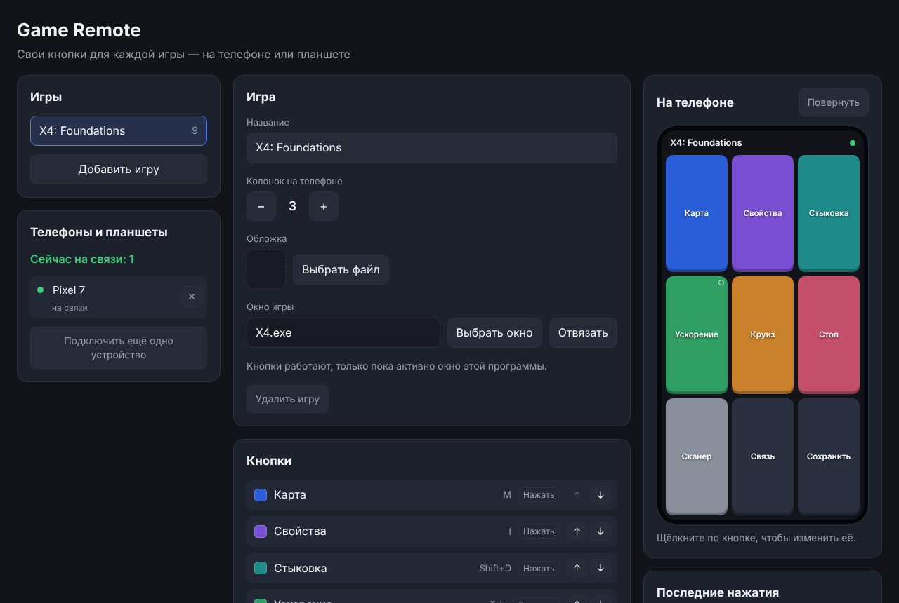
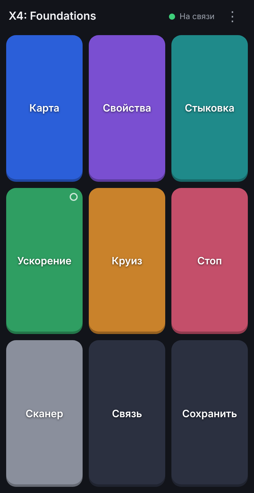
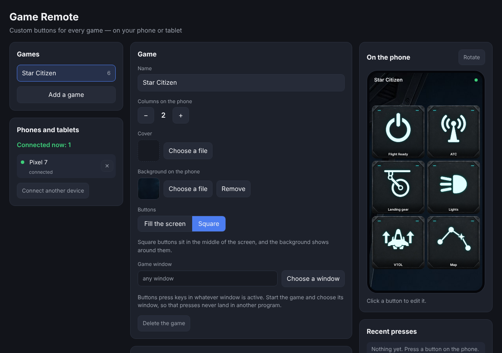
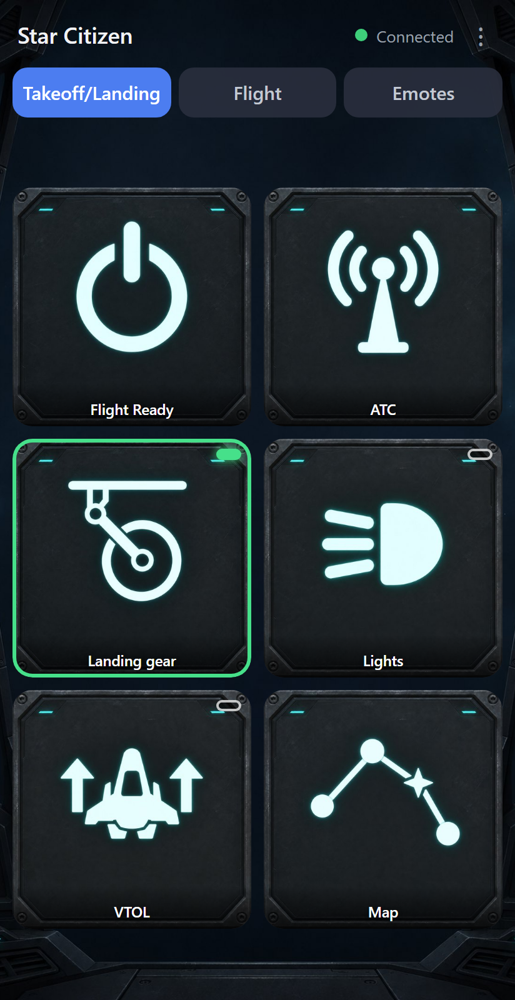

# Game Remote

**Свои кнопки для каждой игры — на телефоне или планшете**  
**Custom buttons for every game — on your phone or tablet**

[Русский](#русский) · [English](#english)

## Русский

Game Remote превращает телефон или планшет в пульт для игр на Windows. На ПК вы собираете панель кнопок для каждой игры, на телефоне открываете её в браузере. Кнопка «Фары» отправляет в игру клавишу `L`, а кнопка типа «держать» зажимает клавишу, пока палец на экране.

<p>
  
  
</p>

- **На телефон ничего не ставится.** Пульт открывается в браузере по QR-коду.
- **Один файл на ПК.** `GameRemote.exe` запускается двойным щелчком, Python не нужен.
- **Своя панель у каждой игры:** подписи, цвета, картинки, фон, сочетания клавиш, порядок кнопок.
- **Кнопки «нажать» и «держать»,** можно нажимать несколько сразу.
- **Экраны:** кнопки одной игры раскладываются по нескольким экранам, на телефоне их переключают вкладки.
- **Наборы:** игру можно сохранить в один файл и поделиться ею, чужой набор — импортировать. У набора могут быть подписи на нескольких языках.
- **Привязка к окну игры:** нажатие не попадёт в чат или браузер.
- **Только ваши устройства:** одноразовый код в QR, свой ключ у каждого телефона, отключение любого из них на ПК.
- Интерфейс на русском и английском.

### Как начать

1. Скачайте `GameRemote.exe` со страницы [Releases](https://github.com/godsfear/game-remote/releases) и запустите его. Файл не подписан, поэтому Windows предупредит. В окне SmartScreen нажмите «Подробнее», затем «Выполнить в любом случае»; в окне «Не удается проверить издателя» нажмите «Запустить».
2. На вопрос брандмауэра Windows разрешите доступ в частных сетях.
3. В браузере откроется страница с QR-кодом. Наведите на него камеру телефона, который подключён к той же Wi-Fi.
4. На телефоне откроется готовая панель Star Citizen. Чтобы собрать свою, нажмите «Добавить игру».

Подробности — в [руководстве](docs/guide.md).

### Что нужно знать

- Программа рассчитана на Windows 10 и 11. Пульт проверен на Android в Chrome; на iOS не проверялся.
- Игры с античитом, который отбрасывает программный ввод, нажатия не видят. Так ведёт себя Undecember. Обходить такую защиту Game Remote не будет.
- Если игра запущена от администратора, Game Remote тоже нужно запустить от администратора.
- Связь между телефоном и ПК не шифруется, и пульт отвечает только устройствам домашней сети. Не пользуйтесь программой в чужой или общественной Wi-Fi.

Как устроена программа и почему: [концепт](CONCEPT.md), [план разработки](PLAN.md), [список изменений](CHANGELOG.md).

## English

Game Remote turns a phone or tablet into a button panel for Windows games. You build a panel for each game on the PC and open it in the phone's browser. A Lights button sends `L` to the game; a hold button keeps its key down while your finger is on the screen.

<p>
  
  
</p>

- **Nothing to install on the phone.** The remote opens in the browser from a QR code.
- **One file on the PC.** `GameRemote.exe` starts with a double click; no Python needed.
- **A panel per game:** labels, colours, pictures, a background, keyboard shortcuts, button order.
- **Tap and hold buttons,** several at a time.
- **Screens:** the buttons of one game can be grouped into several screens; tabs on the phone switch between them.
- **Sets:** a game can be saved into one file and shared, and someone else's set imported. A set can carry its labels in several languages.
- **Bound to the game's window:** a press never lands in a chat or a browser.
- **Your devices only:** a one-time code in the QR link, a key per phone, and any of them can be disconnected on the PC.
- English and Russian interface.

### Getting started

1. Download `GameRemote.exe` from [Releases](https://github.com/godsfear/game-remote/releases) and run it. The file is not signed, so Windows warns. In the SmartScreen window choose "More info", then "Run anyway"; in the "The publisher could not be verified" window choose "Run".
2. When Windows Firewall asks, allow access on private networks.
3. A page with a QR code opens in the browser. Point the camera of a phone on the same Wi-Fi at it.
4. The phone shows a ready-made Star Citizen panel. To build your own, press "Add a game".

The full [guide](docs/guide.md) is in Russian.

### Good to know

- The program is made for Windows 10 and 11. The remote was checked on Android with Chrome; iOS was not checked.
- Games whose anti-cheat drops synthetic input do not see the presses. Undecember is one. Game Remote will not work around such protection.
- If the game runs as administrator, Game Remote must run as administrator too.
- Traffic between the phone and the PC is not encrypted, and the remote answers only devices of the home network. Do not use the program on someone else's or public Wi-Fi.

Design notes, in Russian: [concept](CONCEPT.md), [plan](PLAN.md). [Changelog](CHANGELOG.md).

## Development

Python · FastAPI · Uvicorn · SQLite · Windows `SendInput` · PyInstaller

```
python -m pip install -e ".[dev]"
pytest -q
python -m game_remote          # PC page on http://127.0.0.1:8730, phone panel on port 8731
python -m game_remote --fake-input --no-tray   # record key presses instead of sending them
python tools/build_exe.py      # dist/GameRemote.exe
python tools/smoke_test.py dist/GameRemote.exe
node tests/browser/check.js    # both pages in a real browser; needs `npm install --no-save playwright`
node tools/make_screenshots.js # the pictures in this file
```

A release is built by the `Release` workflow: push a tag such as `v0.1.0` or start it by hand on the Actions page. It makes a draft release with `GameRemote.exe`; publish the draft on the Releases page.

## License

[MIT](LICENSE)
